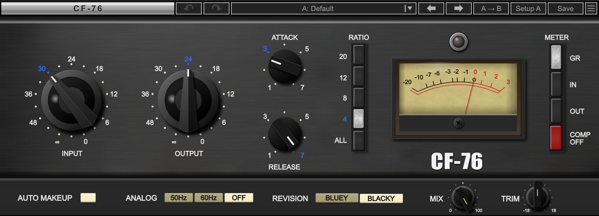
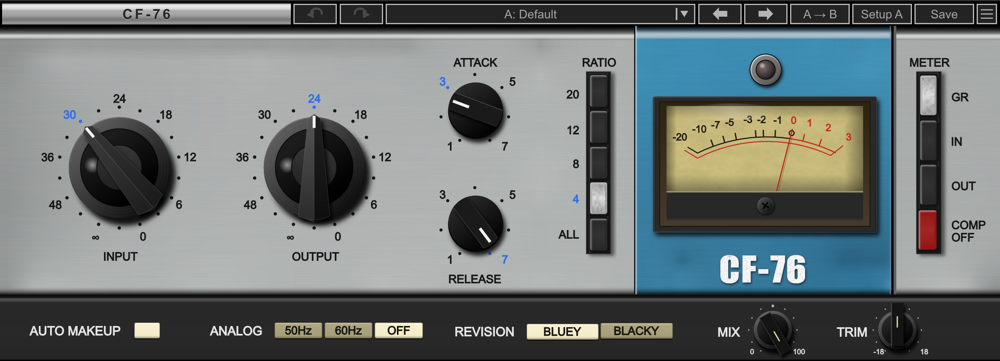

# CF-76: FET Compressor (VST3)

A 1176-style FET compressor/limiter plug-in, written in C++ with [JUCE](https://juce.com) and CMake. The UI is drawn entirely in code, with no bitmap skins. The DSP is a feedback-topology FET compressor model. Its tests check it against the published hardware specs.




*Both screenshots are rendered by the plug-in's own snapshot mode.*

## Features

**Sound**
- **Feedback detector, solved per sample.** As in the hardware, the sidechain taps the signal *after* the gain stage. The loop is solved implicitly each sample with Newton's method, so the ratios come out exact and the loop stays stable even at a 20 µs attack.
- **Hardware ballistics.** Attack runs from 800 µs to 20 µs and release from 1.1 s to 50 ms. Linking the channels for stereo doubles the fastest attack to about 40 µs, as with two linked hardware units.
- **Program-dependent release.** Sustained gain reduction slows the release.
- **Ratios 4 / 8 / 12 / 20 / All.** "All" models the all-buttons-in trick: an over-compressing slope, a bias shift and a transient overshoot.
- **Two revisions, switchable live.** *Bluey* (an early silverface) and *Blacky* (a later blackface LN) differ in FET distortion, transformer headroom, knee, noise floor and release behaviour. Switching also changes the panel skin.
- **Analog stages.** Input transformer and output stage saturation, measured to the THD spec (≤ 0.5 % at +22 dBm). The *Analog* option adds 50/60 Hz hum and noise.
- **2× FIR oversampling** with fixed integer latency that is reported to the host. A latency-matched dry path feeds the **Mix** control, followed by **Trim** (±18 dB).
- **Auto Makeup.** Uses the same static curve as the compressor to set the output level automatically.
- About 2.5 % of one CPU core.

**UI and workflow**
- **Vector-drawn panel.** Brushed-metal lighting, knobs with dot scales, a VU meter with real VU ballistics (GR / In / Out, plus an over lamp) and the illuminated buttons. Everything is drawn from code at any scale.
- **Toolbar.** Undo/redo (UndoManager on the parameter tree), factory and user presets (`Documents/CF76/Presets/*.cf76preset`), A/B setups with copy, a modified (`*`) flag and Save.

## Testing and dev tooling

The project includes its own test harnesses instead of relying on a DAW:

| Tool | How to run | What it checks |
|---|---|---|
| DSP test | `CF76_DSPTEST=<report.txt> CF-76.exe` | Static curves per ratio, attack/release timings, stereo link, program-dependent release, THD per revision. Each figure is compared against the hardware spec ([sample report](docs/dsp_report.txt)) |
| Self-test | `CF76_SELFTEST=<log.txt> CF-76.exe` | 15 preset, A/B, undo/redo and state save/restore checks |
| Host test | `CF76HostTest.exe <path-to-CF-76.vst3>` | Loads the VST3 the way a DAW does: create, open editor, delete, unload module. Written to reproduce and fix a host hang on plug-in deletion |
| Snapshot | `CF76_SNAPSHOT=<dir> CF-76.exe` | Renders both skins to PNG (the screenshots above) |
| UI diff | `python tools/compare.py snap.png ref.png out [x0,y0,x1,y1]` | Side-by-side and diff images, with mean absolute error per region, for pixel-level UI work |

## Building

Requirements: Windows, Visual Studio 2022, CMake ≥ 3.22, and a local JUCE checkout.

```sh
cmake -B build -G "Visual Studio 17 2022" -A x64 -DJUCE_DIR=C:/path/to/JUCE
cmake --build build --config Release
```

Outputs:
- `build/CF76_artefacts/Release/VST3/CF-76.vst3`. A post-build step also copies it to `C:/Program Files/Common Files/VST3`.
- `build/CF76_artefacts/Release/Standalone/CF-76.exe`
- `build/CF76HostTest_artefacts/Release/CF76HostTest.exe`

I developed and tested it in FL Studio.

## Project layout

```
Source/
  DSP/FetCompressor.*   compressor core: oversampling, feedback solver, ballistics, voicing
  Parameters.*          parameter IDs and ranges
  Presets.*             factory/user presets, A/B slots
  PluginProcessor.*     JUCE processor, state, latency
  PluginEditor.*        canvas and layout (reference-pixel coordinates, scaled)
  DevTests.*            DSP and self-test harnesses
  UI/                   Skin, Knob, Buttons, VUMeter, Segmented, TopBar, PanelLighting
tools/
  hosttest/             VST3 lifecycle host test
  compare.py            UI snapshot diff
  gen_lighting.py       generates the panel lighting grid
```

## Notes

This is a personal project, built as a study of the classic 1176 FET limiter and of the software emulations it inspired. It is not affiliated with or endorsed by Universal Audio, Waves or any other company. Third-party manuals and reference screenshots that were used during development are not included in this repository.

## License

[GNU AGPL v3](LICENSE), in line with JUCE's open-source license.
